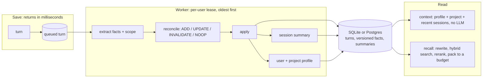

# Agentic Memory

Long-term memory for LLM agents and the products built on them. It **remembers on its own**
(every turn is saved in the background), **updates itself** ("I moved to Pune" replaces "I live
in Bangalore", and the old fact is kept as history), **keeps projects apart** (a fact about one
repo never leaks into another), and **briefs every new session** with a profile of the user, the
project, and what happened last time.

Two ways to run it, same code:
- **On your laptop**, for Claude Code or any MCP client: one SQLite file, no Docker, no server.
- **As a service**, for your product: Postgres + pgvector, a REST API, a Python SDK, tenant keys.

See [plan.md](plan.md) for the roadmap and [docs/decisions](docs/decisions/) for why each choice
was made.

## Give Claude Code a memory (two commands)

```bash
uv tool install "agentic-memory[server] @ git+https://github.com/aman99dex/Agentic_Memory"
agentic-memory setup claude-code
```

The second command writes `~/.agentic-memory/config.env` and installs the Claude Code plugin.
Put an `ANTHROPIC_API_KEY` in that file (the model that turns conversations into memories;
any LangChain provider works, including a local Ollama model). Then use Claude Code as usual:

- every new session starts with what it knows about you, this project, and the latest sessions;
- each turn is saved when Claude finishes answering, and processed by a background worker;
- Claude can also call `recall`, `remember` and `forget` (the bundled MCP server).

```bash
agentic-memory status            # what is stored, what is queued, the last error if any
agentic-memory context           # exactly what a new session in this folder is told
agentic-memory recall "how do I like tests written?"
```

Other MCP clients (Cursor, Windsurf, ...): add `agentic-memory mcp --project <folder>` as a
stdio server. Without hooks, capture depends on the agent calling `remember`.

## Add memory to your product

```bash
pip install agentic-memory             # the SDK only: httpx, nothing of the server
```

```python
from agentic_memory.client import Memory

memory = Memory(user_id, namespace="food-app")  # MEMORY_URL, MEMORY_API_KEY from the env
known = memory.context() + "\n\n" + memory.search(message, mode="facts", rewrite=False).text
reply = your_llm(system=f"What you remember about this user:\n{known}", user=message)
memory.add(message, reply)  # returns at once; learned in the background
```

[examples/chat.py](examples/chat.py) is a complete, runnable version. Run the server yourself:

```bash
cp .env.example .env              # ANTHROPIC_API_KEY, API_KEY (the operator key)
docker compose up --build         # Postgres + migrations + API on http://127.0.0.1:8000
docker compose exec api agentic-memory keys create acme   # one tenant's key, shown once
```

REST: `POST /memories:ingest` (add `"wait": true` to get the facts back),
`/memories:import` (up to 1000 past turns), `/memories:search`, `/memories:context`,
`GET /memories/{id}/history`, `DELETE /memories?ids=`, `DELETE /users/{id}`. Every call takes
`X-API-Key`; interactive docs at `/docs`.

## How it works



- **Facts are search keys, original turns are the answer** (ADR 0003).
- **Changed facts are closed, not overwritten** (ADR 0004): ask what was true on a past date.
- **Hybrid search** (ADRs 0001, 0002, 0005, 0019): vectors plus keywords, fused with RRF.
  Postgres uses pgvector HNSW and `tsvector`; SQLite uses exact numpy search and FTS5 BM25.
- **Saving is a queue** (ADR 0020): a per-user lease means one worker per user, in time order.
- **Scopes, sessions, profiles** (ADR 0021): user-wide versus project facts; a rolling summary of
  the work in each session; a short profile per scope. Summaries are history, so they are only
  searched for questions about past work.
- **Rerank and forgetting** (ADR 0016): importance is earned by being recalled; cold facts are
  archived. `forget` is the only hard delete, and it also removes the summaries built from what
  it deletes.

## Results

Generated by `eval/report.py` from `eval/results/*.json`; never edited by hand.

<!-- results:start -->
No evaluation run yet.
<!-- results:end -->

## Evaluate

```bash
# Data: eval/data/longmemeval_s_cleaned.json (LongMemEval) and eval/data/locomo10.json (LoCoMo)
uv run --env-file .env python -m eval.lme --n 12 --name pilot-12 --concurrency 2
uv run --env-file .env python -m eval.lme --n 12 --name abl-vector --retriever vector --systems ours
uv run python -m eval.report pilot-12 abl-vector --readme   # fills the Results block above
uv run python -m eval.agreement sample pilot-12              # 50 answers to label by hand
```

Ablation flags: `--retriever vector|text`, `--no-history`, `--no-rerank`. `--dataset locomo` runs
LoCoMo. Every model call is cached by prompt, so a rerun costs only what changed (ADR 0015).

## Operate

- **Status:** `agentic-memory status` shows queued and failed turns and the last error.
- **Workers:** the API and the MCP server each run one; `agentic-memory worker` runs a standalone
  one. Any number is safe.
- **Load test:** `uv sync --group load`, then `LOAD_NAME=load-1 uv run --env-file .env locust -f loadtest/locustfile.py --headless -u 50 -r 5 -t 2m --host http://127.0.0.1:8000`.
- **Telemetry:** set `OTEL_EXPORTER_OTLP_ENDPOINT` for spans and token/cost counters (ADR 0018).
- **Nightly forgetting:** `python -m agentic_memory.decay` on a schedule (Postgres).
- **Deploy:** Cloud Run + Neon through GitHub Actions, no stored keys. See [docs/deploy.md](docs/deploy.md).

## Development

```bash
uv sync                                         # the dev group includes agentic-memory[server]
uv run --env-file .env python -m pytest         # Postgres via testcontainers + SQLite; Docker needed
uv run ruff check . && uv run ruff format --check . && uv run mypy
claude -p "hello" --plugin-dir plugin           # try the Claude Code plugin from this checkout
```

Store tests run once per database: SQLite and Postgres must behave the same.

## Decisions

Every non-trivial choice has an ADR with the options considered and the trade-off:
[docs/decisions](docs/decisions/README.md). The concepts behind the code are explained for a
learner in [docs/learn](docs/learn/).

The `archive/course-notebooks/` folder holds the DeepLearning.AI course material I learned
from. It is not part of this project; see its CREDITS.md.
