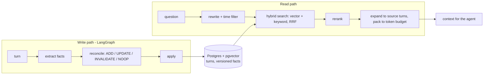

# Agentic Memory

Long-term memory for LLM agents. It **updates itself** ("I moved to Pune" replaces "I live in
Bangalore"), **knows when a fact stopped being true**, and **fits under a token budget**. Postgres +
pgvector, a LangGraph write path, hybrid retrieval, a REST API, an MCP server, a Python SDK, and
evaluation on LongMemEval and LoCoMo against full-context and naive-RAG baselines.

Self-hostable with one `docker compose up`. See [plan.md](plan.md) for the roadmap and
[docs/decisions](docs/decisions/) for why each choice was made.

## How it works



- **Facts are search keys, original turns are the answer** (ADR 0003): the detail survives
  extraction.
- **Bi-temporal facts** (ADR 0004): a changed fact is closed, not overwritten, so you can ask what
  was true on a past date.
- **Hybrid search** (ADR 0001, 0002, 0005): pgvector HNSW with iterative scan for per-user filters,
  Postgres full-text, fused with Reciprocal Rank Fusion.
- **Rerank and forgetting** (ADR 0016): importance is earned by being recalled; cold facts are
  archived, never deleted. `forget` is the only hard delete, and it is by explicit id.

## Results

Generated by `eval/report.py` from `eval/results/*.json`; never edited by hand.

<!-- results:start -->
No evaluation run yet.
<!-- results:end -->

## Quickstart

```bash
uv sync
cp .env.example .env          # then fill in ANTHROPIC_API_KEY and API_KEY
docker compose up --build     # database + migrations + API on http://127.0.0.1:8000
```

Or run the pieces yourself (Docker Desktop must be running for the database):

```bash
docker compose up -d db
uv run --env-file .env python -m agentic_memory.migrate
uv run --env-file .env python -m agentic_memory.serve      # REST API, docs at /docs
```

Every REST call needs the `X-API-Key` header.

```bash
curl -X POST localhost:8000/memories:ingest -H "X-API-Key: $API_KEY" -H 'content-type: application/json' \
  -d '{"user_id":"me","session_id":"s1","user_text":"I moved to Pune."}'
curl -X POST localhost:8000/memories:search -H "X-API-Key: $API_KEY" -H 'content-type: application/json' \
  -d '{"user_id":"me","query":"Where do I live?"}'
```

### Python SDK

```python
from agentic_memory.client import Memory

mem = Memory("me", base_url="http://127.0.0.1:8000", api_key="...")
mem.add("I moved to Pune.")
print(mem.search("Where do I live?").text)
```

### MCP (Claude Code and other agents)

```bash
claude mcp add agentic-memory -- uv run --directory <this repo> --env-file .env python -m agentic_memory.mcp_server
```

Tools: `remember`, `recall`, `forget`, for the single user in `MEMORY_USER_ID`.

## Evaluate

```bash
# Data: eval/data/longmemeval_s_cleaned.json (LongMemEval) and eval/data/locomo10.json (LoCoMo)
uv run --env-file .env python -m eval.lme --n 12 --name pilot-12 --concurrency 2
uv run --env-file .env python -m eval.lme --n 12 --name abl-vector --retriever vector --systems ours
uv run python -m eval.report pilot-12 abl-vector --readme   # fills the Results block above
uv run python -m eval.agreement sample pilot-12              # 50 answers to label by hand
```

Ablation flags: `--retriever vector|text`, `--no-history`, `--no-rerank`. `--dataset locomo` runs
LoCoMo. Every model call is cached by prompt, so a rerun costs only what changed (ADR 0015).

## Operate

- **Load test:** `uv sync --group load`, then `LOAD_NAME=load-1 uv run --env-file .env locust -f loadtest/locustfile.py --headless -u 50 -r 5 -t 2m --host http://127.0.0.1:8000`.
- **Telemetry:** set `OTEL_EXPORTER_OTLP_ENDPOINT` for spans and token/cost counters (ADR 0018).
- **Nightly forgetting:** `python -m agentic_memory.decay` on a schedule.
- **Deploy:** Cloud Run + Neon through GitHub Actions, no stored keys. See [docs/deploy.md](docs/deploy.md).

## Development

```bash
uv run --env-file .env python -m pytest        # tests start their own throwaway Postgres
uv run ruff check . && uv run ruff format --check . && uv run mypy
```

## Decisions

Every non-trivial choice has an ADR with the options considered and the trade-off:
[docs/decisions](docs/decisions/README.md). The concepts behind the code are explained for a
learner in [docs/learn](docs/learn/).

The `archive/course-notebooks/` folder holds the DeepLearning.AI course material I learned
from. It is not part of this project; see its CREDITS.md.
